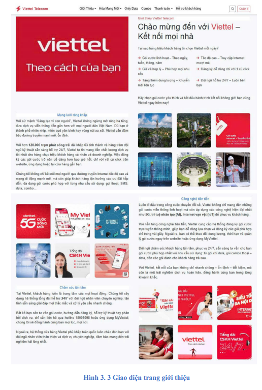
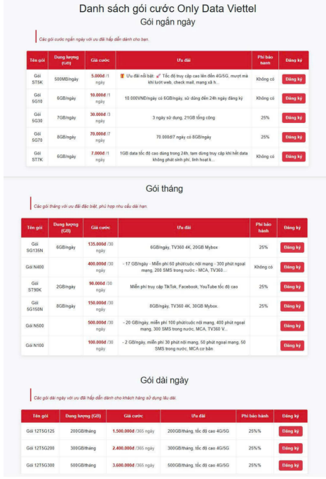
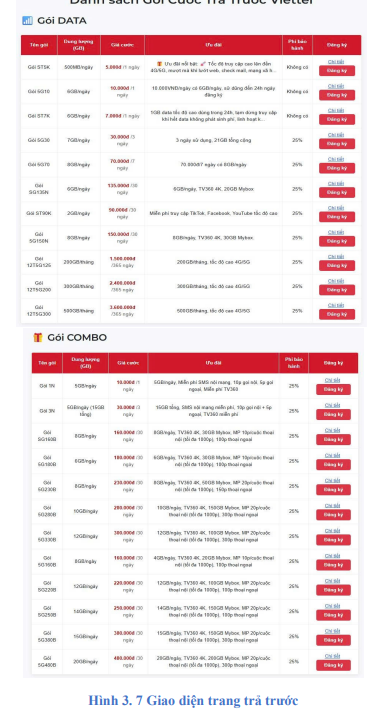
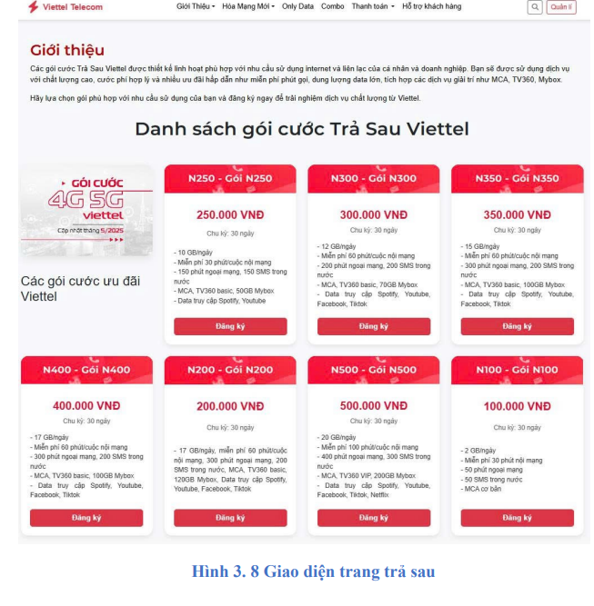
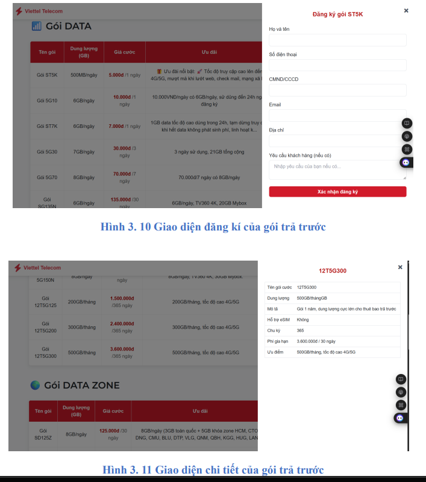
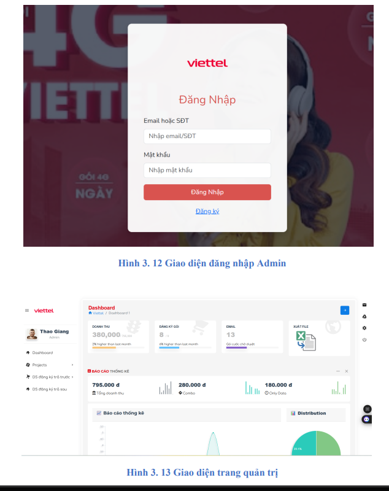
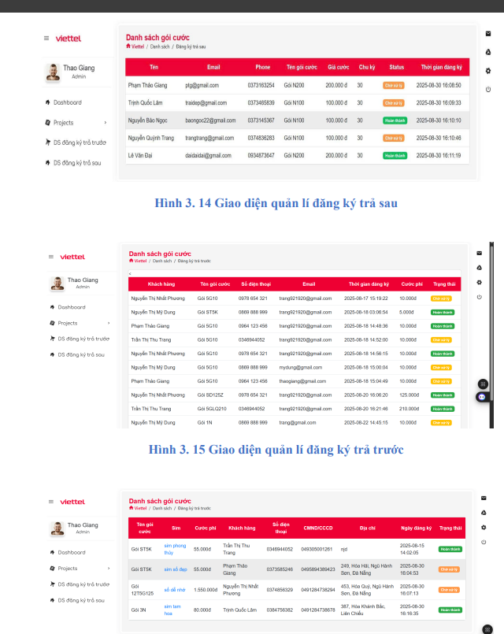

# Viettel Subscription

Website đăng ký gói cước Viettel bằng Laravel, giúp khách hàng xem, tìm kiếm và đăng ký các gói data, combo, trả trước, trả sau, cùng dashboard quản trị cho admin.

## Mục tiêu dự án

- Hiển thị danh sách gói cước điện thoại Viettel theo loại và mạng 4G/5G.
- Tạo trải nghiệm đặt mua gói cước dễ dàng cho khách hàng.
- Hỗ trợ đăng nhập, đăng ký tài khoản và xác thực OTP qua email.
- Cung cấp dashboard cho admin để quản lý gói cước và thống kê doanh thu.
- Thiết kế theo mô hình web app quản lý dịch vụ viễn thông.

## Tính năng chính

- Đăng nhập / đăng ký / logout
- Xác thực OTP qua email
- Trang danh mục gói cước: data, combo, trả trước, trả sau
- Tìm kiếm gói theo mã hoặc tên
- Chọn SIM và đăng ký gói
- Quản lý gói cước (thêm, sửa, xóa)
- Dashboard admin với thống kê: số đăng ký, doanh thu, số người dùng, số gói
- Xuất báo cáo thống kê

## Giao diện minh họa

Các ảnh giao diện được lưu trong thư mục `docs/images/` để hiển thị đúng trên GitHub.

### 1. Trang chủ / giới thiệu dịch vụ



### 2. Danh sách gói Only Data



### 3. Danh sách gói Data và Combo



### 4. Trang giới thiệu gói trả sau



### 5. Form đăng ký gói DATA



### 6. Giao diện đăng nhập Admin



### 7. Dashboard quản trị



## Stack công nghệ

- PHP 8.2
- Laravel 12
- SQLite (mặc định trong `.env.example`)
- Vite + Tailwind
- Blade templates
- Composer + npm

## Cấu trúc dự án

```text
app/
  Http/Controllers/
  Models/
config/
database/
docs/
  images/
public/
resources/
routes/
storage/
tests/
Dockerfile
README.md
render.yaml
composer.json
package.json
```

## Quy trình nghiệp vụ

### Khách hàng

1. Truy cập trang chủ và xem danh sách gói.
2. Chọn loại gói phù hợp.
3. Điền thông tin khách hàng / SIM nếu cần.
4. Gửi đăng ký.
5. Chờ admin xử lý hoặc kích hoạt gói.

### Admin

1. Đăng nhập với tài khoản có role `admin`.
2. Vào dashboard quản trị.
3. Quản lý các gói cước và theo dõi trạng thái đơn đăng ký.
4. Xem báo cáo và xuất thống kê.

## Yêu cầu môi trường

- PHP >= 8.2
- Composer
- Node.js >= 18
- Git

## Cài đặt nhanh

```bash
git clone <repo-url>
cd viettel-subscription
composer install
npm install
cp .env.example .env
php artisan key:generate
```

### Cấu hình database

Dự án mặc định dùng SQLite:

```bash
touch database/database.sqlite
```

Sau đó chạy migration:

```bash
php artisan migrate
```

Nếu muốn seed dữ liệu mẫu:

```bash
php artisan db:seed
```

## Chạy ứng dụng

```bash
npm run dev
php artisan serve
```

Mở trình duyệt tại:

```text
http://localhost:8000
```

## Build production

```bash
npm run build
php artisan optimize
php artisan config:cache
php artisan route:cache
php artisan view:cache
```

## Triển khai

- `render.yaml`: cấu hình deploy lên Render
- `Dockerfile`: build container cho ứng dụng

## Tài liệu chi tiết

Xem thêm tại: [docs/PROJECT_DOCUMENTATION.md](./docs/PROJECT_DOCUMENTATION.md)

## Lưu ý

- Mặc định mail trong môi trường dev được cấu hình theo `MAIL_MAILER=log`, nên OTP sẽ được ghi log thay vì gửi thật.
- Hệ thống phân quyền dựa trên cột `role` trong bảng `users`.
- Để truy cập chức năng admin, tài khoản cần có `role = admin`.

## License

Dự án này được phát hành theo giấy phép MIT.
